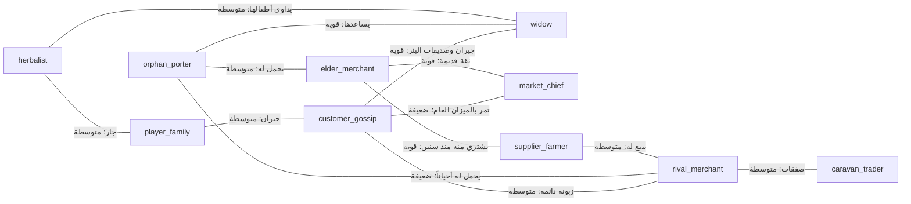

# تصميم الشخصيات (CHARACTER_DESIGN)

> مسؤولية هذه الوثيقة: **من يسكن البلدة**: الشخصية التي يلعبها اللاعب، والأدوار الإحدى عشرة بسماتها ودوافعها وجداولها ووظيفتها في الأنظمة، وتعريف السمات، ومسودة شبكة العلاقات. القائمة الملزمة في [PRD §5.2](PRD.md)؛ الأماكن في [WORLD_DESIGN.md](WORLD_DESIGN.md)، وقواعد كلام الشخصيات في [NARRATIVE_DESIGN.md §6](NARRATIVE_DESIGN.md).

## 1. مبادئ
| # | المبدأ | المرجع |
|---|---|---|
| C-1 | لا نبي ولا ملَك في البلدة، ولا شخصية تمثّل أحداً منهم أو توحي به بصرياً أو صوتياً. شعيب عليه السلام وقومه لا يظهرون في المحاكاة ولا يُتحدث عنهم كحدث معاصر. | S1، F2 |
| C-2 | كل الشخصيات خيالية، ولا تقتبس القرآن أو الحديث، ولا تتكلم في الدين حتى حسم SR-10. | F3، SR-10 |
| C-3 | لكل شخصية ذاكرة مستقلة لا تعرف إلا ما شهدته أو سمعته. سلوكها تجاه اللاعب من **معتقداتها** لا من الحقيقة. | FR-M1، FR-R2 |
| C-4 | لا شرير كرتوني ولا قديس كامل: لكل شخصية دافع مفهوم وحاجة. | [VISION §3](VISION.md) |
| C-5 | الكرامة للمحتاجين: الأرملة واليتيم شخصيات كاملة لا أدوات شفقة. | [PLAYER_EXPERIENCE §7](PLAYER_EXPERIENCE.md) |
| C-6 | السمات تحكم السلوك عبر البيانات، لا عبر شروط في الكود باسم الشخصية. | FR-D4، PRD §8.5 |

## 2. تعريف السمات
السمات الثماني من PRD §5.2. الشخصية قد تحمل أكثر من سمة. القيم الرقمية تُضبط في مهام الأنظمة المذكورة.

| السمة | المعنى | أثرها في الأنظمة | المهمة |
|---|---|---|---|
| `observant` | ملاحظ | مدى رؤية وانتباه أعلى عند حساب الشهود (FR-P1)؛ يلاحظ الغش الخفيف المتكرر | [TASK-M05-001](../tasks/M05/TASK-M05-001.md) |
| `gossip` | ينقل الأخبار | احتمال نقل أعلى في دورة الشائعات (FR-M3)؛ مجموعة barks عن أخبار الناس | [TASK-M05-005](../tasks/M05/TASK-M05-005.md) |
| `forgiving` | متسامح | تلاشٍ أسرع للمعتقدات السلبية الصغيرة (FR-M5)؛ استعادة ثقة أسرع بعد الرد والاعتذار | [TASK-M05-007](../tasks/M05/TASK-M05-007.md)، [TASK-M05-011](../tasks/M05/TASK-M05-011.md) |
| `grudge` | لا ينسى الإساءة | الذكريات الكبيرة تبقى أقوى (FR-M5)؛ قد لا يسامح أبداً (FR-R4) | [TASK-M05-007](../tasks/M05/TASK-M05-007.md)، [TASK-M05-011](../tasks/M05/TASK-M05-011.md) |
| `skeptic` | لا يصدق الشائعات بسهولة | يرفض الخبر أو يؤجل الحكم (FR-M4)؛ عتبة ثقة أعلى لقبول السماع | [TASK-M05-006](../tasks/M05/TASK-M05-006.md) |
| `greedy` | جشع | يغش أو يعرض صفقات مغرية؛ يرفع أسعاره؛ سطور إغراء من الخارج | [TASK-M12-019](../tasks/M12/TASK-M12-019.md) |
| `honest` | أمين | لا يغش؛ يحذّر غيره ممن يعتقد أنه غشاش؛ تزكيته مؤثرة | [TASK-M05-010](../tasks/M05/TASK-M05-010.md) |
| `needy` | محتاج | حاجات أسرته تنقص بسرعة (FR-T4)؛ تولد مواقف رحمة؛ أثر الغش عليه أوضح في المراجعة | [TASK-M04-003](../tasks/M04/TASK-M04-003.md) |

قاعدة: السمة **لا تغيّر الحقيقة**، بل كيف تُدرَك وتُنقل وتُنسى. ولا سمة تجعل شخصية "تعرف" ما لم تشهده.

## 3. الشخصية التي يلعبها اللاعب
| البند | التصميم |
|---|---|
| الهوية | تاجر شاب في البلدة، له دكان وبيت وأسرة. دافعه إعالة الأسرة وتوسيع الدكان (PRD §5.3). |
| الجنس | ذكر أو أنثى (PRD §7.14). **الشخصيتان تُبنيان، ولا تُشحن الأنثى قبل حسم SR-08** (السلوك الافتراضي). |
| الملامح واللباس | خيارات محدودة للملامح، ولباس محتشم في كل الخيارات بلا استثناء ([TASK-M10-005](../tasks/M10/TASK-M10-005.md)، [TASK-M10-008](../tasks/M10/TASK-M10-008.md)). |
| الاسم | يُدخله اللاعب بالعربية (حالة اختبار في PRD §8.3)، مع اسم افتراضي. لا تحقق ولا رفع للاسم لأي جهة (S13). |
| الصوت | *(مقترح)* اللاعب لا صوت مسجل له في الحوار؛ خياراته نص. صوتاه الداخليان ليسا شخصيتين (S8) ويُعرَّفان في [NARRATIVE_DESIGN §5](NARRATIVE_DESIGN.md) و[AUDIO_DESIGN §5](AUDIO_DESIGN.md). |
| مخاطبة اللاعب | كل سطر يخاطب اللاعب له صيغتا تذكير وتأنيث، أو صياغة محايدة ([NARRATIVE_DESIGN §6](NARRATIVE_DESIGN.md)). |
| ما لا يفعله | لا قتال، لا سرقة، لا ربا ولا قروض ([GDD §2](GDD.md)). |

## 4. الأدوار الإحدى عشرة
السمات من PRD §5.2 كما هي. المعرّفات والدوافع والجداول **مقترحة**، وتُثبَّت في [TASK-M03-011](../tasks/M03/TASK-M03-011.md) (النموذج) و[TASK-M12-003](../tasks/M12/TASK-M12-003.md) (MVP). أوقات الجدول بمراحل [WORLD_DESIGN §4](WORLD_DESIGN.md).

| الدور | المعرّف | السمات | الدافع | الجدول المختصر | الوظيفة في الأنظمة | أول ظهور |
|---|---|---|---|---|---|---|
| تاجر منافس | `rival_merchant` | greedy, observant | يريد أن يكون أغنى تجار السوق، ويخاف الخسارة أمام اللاعب | فجر: يشتري؛ ضحى–عصر: دكانه المجاور؛ مساء: البئر أو بيته | الغاش الرابح (FR-T5)؛ يغري اللاعب؛ مصدر خلط الفاعل والبهتان (FR-M2) | M03 |
| تاجر أمين مسن | `elder_merchant` | honest, forgiving | يريد أن يورث سمعة طيبة وأن يرى السوق عادلاً | ضحى–عصر: دكانه؛ مساء: الحي | مرشد؛ تزكيته أو تحذيره تؤثر في غيره؛ مثال أن الأمانة تعيش | VS *(مقترح)* |
| كبير السوق | `market_chief` | skeptic, observant | حفظ نظام السوق وثقة الناس به | ضحى: جولة على الموازين؛ ظهر: الميزان العام | يفحص الموازين ويكشف الصنجات المغشوشة (FR-P3)؛ مسار التبرئة بالفحص (FR-M7) | M03 |
| مورّد مزارع | `supplier_farmer` | honest, grudge | بيع محصوله بثمن عادل لمن يثق به | فجر: طريق السوق ومنصته؛ ضحى–عصر: المراعي والحقول | سعره ووصوله يتأثران بمعتقده (FR-R3)؛ قد يمتنع عن البيع؛ قد لا يسامح (FR-R4) | VS *(مقترح)* |
| زبونة | `customer_gossip` | gossip | تدبير بيتها بأقل كلفة، وتحب أن تكون أول من يعرف | ضحى: السوق؛ ظهر: البئر؛ عصر–مساء: الحي | أسرع ناقل للأخبار؛ تزن في بيتها (FR-T3)؛ أكثر من يولّد الاتهام الخاطئ بميزانها المعيب (FR-M2) | M03 |
| أرملة وأطفالها | `widow` (+ أسرة) | needy | إطعام أطفالها دون أن تفقد كرامتها | صباح: البئر؛ ضحى: السوق للشراء القليل؛ مساء: بيتها | سيناريوهات الرحمة والصدقة السرية (FR-L4، [TASK-M12-005](../tasks/M12/TASK-M12-005.md))؛ حاجاتها تتغير فعلاً بالمساعدة (FR-T4) | M12 |
| صبي حمّال يتيم | `orphan_porter` | needy, observant | لقمة اليوم، ثم أن يجد من يثق به | ضحى–عصر: يتنقل بين الدكاكين والطريق؛ مساء: قرب البئر | شاهد محتمل يتحرك في السوق؛ علاقة تتطور ([TASK-M12-006](../tasks/M12/TASK-M12-006.md))؛ مدافع عند الشائعات (FR-M6) | VS *(مقترح)* |
| تاجر قافلة غريب | `caravan_trader` | greedy | ربح سريع ثم الرحيل | يصل في يوم محدد إلى طريق القوافل، ويغادر بعد مدة (F8) | صفقة مغرية لمرة واحدة ([TASK-M12-004](../tasks/M12/TASK-M12-004.md))؛ ضحية متعذر الوصول إليها فيُتصدق عنه (FR-W3) | M12 |
| لص | `thief` | greedy | المال بلا تعب | يظهر قليلاً؛ نشاطه عبر حدث حياة لا عبر مواجهة | السرقة حدث `LIFE_EVENT` بمعدل واحد لكل اللاعبين (FR-K2)؛ لا يستهدف أحداً بحسب أخلاقه (SR-09)؛ لا قتال ولا مطاردة | M12 |
| عشّاب أو مداوٍ | `herbalist` | forgiving | علاج الناس وكسب رزقه | ضحى–عصر: دكانه أو بيته؛ زيارات للبيوت عند المرض | المرض والعلاج والنفقات ([TASK-M12-007](../tasks/M12/TASK-M12-007.md))؛ لا ادعاءات غيبية ولا علاج بالرقى في كلامه (SR-10) | M12 |
| أسرة اللاعب | `player_family` | forgiving | العيش الكريم، وأن يكون اللاعب بخير | البيت؛ قد يخرج فرد للبئر صباحاً | مصدر الحاجة المالية (PRD §5.3، [TASK-M12-008](../tasks/M12/TASK-M12-008.md))؛ تتأثر بقراراته | M02 (حاجات)، M12 (كاملة) |

**قواعد خاصة:**
- **الأسرة** تعبّر عن الحاجة ولا تطلب الغش أبداً، ولا توبّخ اللاعب على الأمانة.
- **المنافس** يغري ويبهت وفق قواعد سلوكه العامة ([TASK-M05-014](../tasks/M05/TASK-M05-014.md)، [TASK-M12-019](../tasks/M12/TASK-M12-019.md))، لا عقاباً مكتوباً على رفض اللاعب ([PLAYER_EXPERIENCE §4](PLAYER_EXPERIENCE.md)). أسلوب الغش الذي يعرضه بمصطلحات اللعبة فقط (S10).
- **اللص** لا يُصوَّر مخيفاً، ولا يُربط وجوده بذنب اللاعب في أي نص (FR-K3، FR-J5).
- **الزبائن العامّون** (غير المسمّين) يملكون ذاكرة ومعتقدات كالمسمّين، بسمات من مجموعة محدودة.

## 5. مسودة شبكة العلاقات
القيم الأولية لقوة العلاقات ومعاملات النقل تُصمم في [TASK-M05-004](../tasks/M05/TASK-M05-004.md). الرسم يوضح المسارات المتوقعة لانتقال الأخبار، لا قيماً نهائية.

**مسارات مقصودة:**
- **الزبونة ← الأرملة ← الصبي:** أسرع مسار لانتشار خبر في الأحياء.
- **الصبي ← التاجر المسن ← كبير السوق:** مسار شهادة الصبي حين يُطلب استشهاده (FR-M7)، ويمر بأشخاص ذوي ثقة.
- **المورّد `grudge`:** يسمع غالباً عبر المنافس أو التاجر المسن، فيختلف ما يصله بحسب من سبق.
- **تاجر القافلة:** صلته الوحيدة بالمنافس، فيغادر وخبره قليل الانتشار.
- علاقة كل شخصية **باللاعب** (`trust`، `affection`، FR-R1) منفصلة عن هذه الشبكة وتبدأ من قيم محايدة *(مقترح)*، عدا الأسرة.

## 6. التصميم البصري
- لباس محتشم لكل الشخصيات ذكوراً وإناثاً ([TASK-M10-008](../tasks/M10/TASK-M10-008.md)، مراجعة شرعية)، وتصور فني لا تاريخي (S6، [WORLD_DESIGN §6](WORLD_DESIGN.md)).
- ظلال (silhouettes) مميزة لكل دور يعرفها الطفل من بعيد: منصة المورّد، ثوب كبير السوق، حمل الصبي.
- لا تنميط عرقي ولا مبالغة كاريكاتورية. الجشع يُفهم من السلوك لا من ملامح قبيحة.
- الأطفال (أطفال الأرملة، الصبي) بمظهر لائق، ولا مشاهد إيذاء لهم.
- ضوابط الشخصيات الأنثوية في السوق (لباس وتعامل) خاضعة لـ SR-08 كالشخصية الأنثى للاعب، وأي قرار فيها يمر بالمراجع.

## 7. مهام مرتبطة
- [TASK-M03-001](../tasks/M03/TASK-M03-001.md): بيانات الشخصيات والسمات.
- [TASK-M03-003](../tasks/M03/TASK-M03-003.md): الجداول اليومية.
- [TASK-M03-011](../tasks/M03/TASK-M03-011.md): شخصيات النموذج الثلاث.
- [TASK-M05-004](../tasks/M05/TASK-M05-004.md): شبكة العلاقات.
- [TASK-M10-005](../tasks/M10/TASK-M10-005.md)، [TASK-M10-008](../tasks/M10/TASK-M10-008.md): إنشاء الشخصية والنماذج المحتشمة.
- [TASK-M12-003](../tasks/M12/TASK-M12-003.md): الأدوار الإحدى عشرة.
- [TASK-M12-004](../tasks/M12/TASK-M12-004.md)، [TASK-M12-005](../tasks/M12/TASK-M12-005.md)، [TASK-M12-006](../tasks/M12/TASK-M12-006.md)، [TASK-M12-007](../tasks/M12/TASK-M12-007.md)، [TASK-M12-008](../tasks/M12/TASK-M12-008.md): أدوار MVP.
- [TASK-M12-019](../tasks/M12/TASK-M12-019.md): سلوك المنافس المتقدم.
