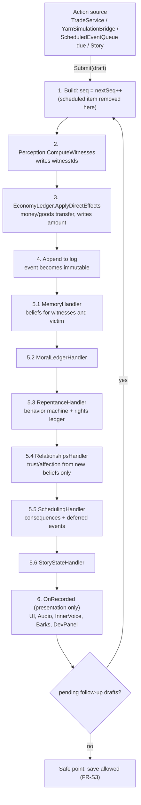
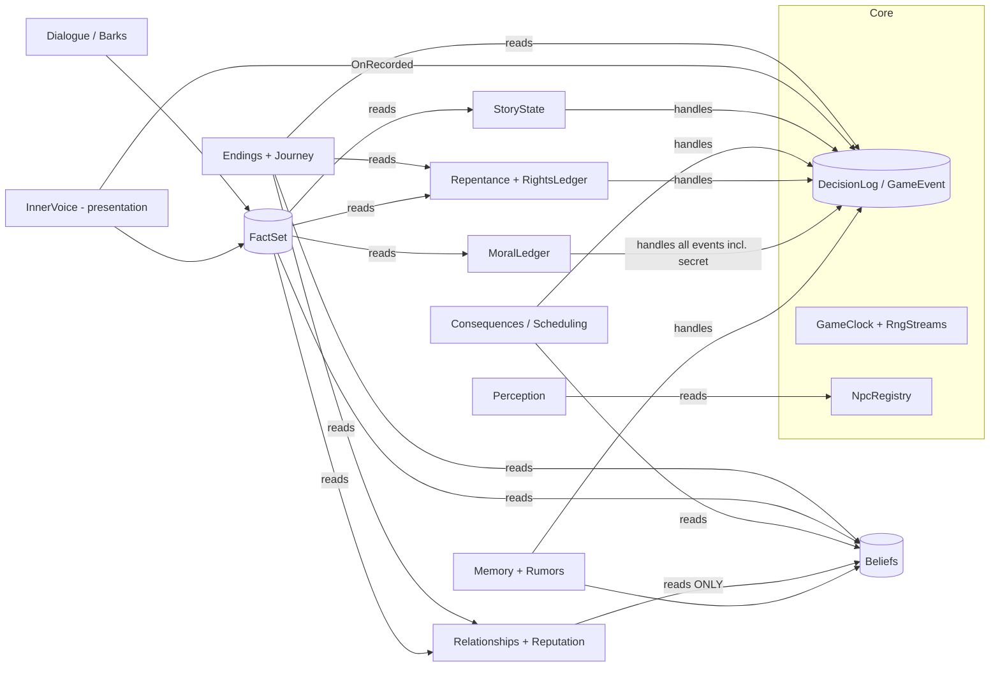

# البنية التقنية (Technical Architecture)

المرجع الملزم: [PRD القسم 7 و8](PRD.md). هذه الوثيقة تشرح **كيف** نبني ما يطلبه PRD، ولا تضيف متطلبات. القرارات المعتمدة في [planning/DECISIONS.md](../planning/DECISIONS.md) (خصوصاً D-001، D-002، D-004، D-005، D-011، D-012).

**المبدأ الحاكم:** استخدم أبسط تصميم يبقي الأشياء منظمة. كل طبقة تجريد يجب أن تبرر نفسها ببديل حقيقي متوقع أو باختبار يحتاجها. لعبة فيها بلدة واحدة و12 شخصية وآلاف الأحداث لا تحتاج بنية مؤسسية؛ تحتاج حتمية وحفظاً صحيحاً واختبارات سريعة.

## 1. المكدس (PRD 8.1)
| المكون | الاختيار | ملاحظة |
|---|---|---|
| المحرك | Unity 6 + URP | D-001، macOS أولاً |
| الإدخال | Input System | ملف Input Actions قابل لإعادة التعيين ([TASK-M02-001](../tasks/M02/TASK-M02-001.md)) |
| الكاميرا | Cinemachine | شخص ثالث مع تفادي التصادم |
| الحركة | AI Navigation (NavMesh) | للشخصيات فقط؛ المحاكاة لا تعرف NavMesh |
| الحوار المتفرع | Yarn Spinner | D-006 |
| السطور العابرة والصوتان | محدد قواعد خاص يقرأ JSON | FR-D2 |
| الترجمة | Unity Localization | العربية فقط في الإصدار الأول ([LOCALIZATION.md](LOCALIZATION.md)) |
| عرض العربية | يُحسم في [TASK-M01-022](../tasks/M01/TASK-M01-022.md) | المرشحان في PRD 8.3، D-003 |
| التسلسل | Newtonsoft JSON بترتيب مفاتيح قانوني | D-005، [SAVE_SYSTEM.md](SAVE_SYSTEM.md) |
| الاختبارات | Unity Test Framework (EditMode وPlayMode) | T1–T9 في CI |
| Addressables | **لا** حتى وجود عالم ثانٍ | PRD 8.1 |

## 2. تخطيط التجميعات (Assemblies)
| asmdef | المسار | يعتمد على | قيود |
|---|---|---|---|
| `IslamicGame.Simulation` | `unity/Assets/_Project/Scripts/Simulation/` | Newtonsoft.Json (precompiled) فقط | `noEngineReferences=true`. لا `UnityEngine`، لا `System.Random`، لا `DateTime.Now`. |
| `IslamicGame.Runtime` | `Scripts/Runtime/` | Simulation، Input System، Cinemachine، AI Navigation، Localization، Yarn Spinner، حزمة عرض النص المختارة | MonoBehaviours وعرض فقط؛ لا منطق محاكاة. |
| `IslamicGame.Editor` | `Scripts/Editor/` | Runtime، Simulation | منصة Editor فقط: `ContentValidator`، `TanzilImporter`، `BuildScripts`، مصدّر جداول المراجعة. |
| `IslamicGame.Tests.EditMode` | `Tests/EditMode/` | Simulation، Editor، NUnit | اختبارات حتمية ببذرة ثابتة، تشمل T1–T9. |
| `IslamicGame.Tests.PlayMode` | `Tests/PlayMode/` | Runtime، Simulation | تكامل المشاهد (حوار، تفاعل، حركة). |

اتجاه الاعتماد واحد: `Editor/Tests → Runtime → Simulation`. المحاكاة لا ترى ما فوقها. فحص CI بـ grep يمنع `UnityEngine` و`System.Random` و`DateTime.Now` داخل `Scripts/Simulation` (معيار في [M01](../milestones/M01.md)).

مجلدات المحاكاة حسب [AGENTS.md](../AGENTS.md): `Core/ Perception/ Memory/ Rumors/ Social/ Economy/ Moral/ Consequences/ Repentance/ InnerVoice/ Dialogue/ Narrative/ Endings/ Journey/ Save/`. سجل الأماكن وسجل الشخصيات وجداولها أساسيات عالم يقرؤها أكثر من نظام، فتسكن `Core/`.

## 3. جذر التركيب (Composition Root)
لا إطار DI. التركيب يدوي في مكانين فقط:

1. **`SimulationWorld`** (`Simulation/Core/SimulationWorld.cs`، C# عادي): ينشئ كل أنظمة المحاكاة بالترتيب، ويمرر لكل منها ما يحتاجه في المُنشئ، ويبني قائمة المعالجات الثابتة، ويملك `Step()`. تستخدمه اختبارات EditMode مباشرة لتشغيل سيناريو كامل بلا مشهد (T3، T5).
2. **`GameRoot`** (`Runtime/Bootstrap/GameRoot.cs`، MonoBehaviour واحد في المشهد، [TASK-M02-012](../tasks/M02/TASK-M02-012.md)): يحمّل المحتوى (TextAsset → نص JSON)، ينشئ `SimulationWorld` جديداً أو من لقطة، يربط مكونات العرض (يشترك في `OnRecorded`)، ويمرر مراجع الأنظمة للـ MonoBehaviours التي تحتاجها عبر حقول تُعيَّن من الكود، ويقود الزمن من `Update`.

```csharp
public sealed class SimulationWorld {
    public GameClock Clock { get; } public RngStreams Rng { get; }
    public DecisionLog Log { get; } public ScheduledEventQueue Scheduled { get; }
    public NpcRegistry Npcs { get; } public Perception Perception { get; }
    public EconomyLedger Economy { get; } public TradeService Trade { get; }
    public MemoryStore Memory { get; } public RumorSystem Rumors { get; }
    public Relationships Relationships { get; } public Reputation Reputation { get; }
    public MoralLedger Moral { get; } public RepentanceSystem Repentance { get; }
    public StoryState Story { get; } public LineHistory LineHistory { get; }
    public static SimulationWorld CreateNew(ContentDatabase content, ulong seed);
    public static SimulationWorld Restore(ContentDatabase content, SaveSnapshot snapshot);
    public void Step();                       // خطوة زمن ثابتة واحدة
    public bool IsAtSafePoint { get; }        // FR-S3
}
```

لا Singletons للحالة القابلة للحفظ: كل حالة يصل إليها الكود عبر `SimulationWorld` الذي يملكه `GameRoot`.

## 4. قواعد التواصل (PRD 8.2، D-004)
| الحالة | الأسلوب | مثال |
|---|---|---|
| مستهلك واحد معروف | استدعاء مباشر لصنف محدد | `ScaleInteraction` ← `TradeService.Sell(...)`؛ `DecisionLog` ← `Perception.ComputeWitnesses(draft)` |
| معالجات تغيّر الحالة المحفوظة | قائمة ثابتة الترتيب يستدعيها `DecisionLog` | `ISimulationHandler[]` تُبنى مرة في `SimulationWorld` |
| العرض | حدث C# `DecisionLog.OnRecorded` | واجهة، صوت، الصوتان الداخليان، barks، لوحة التطوير |
| حد له بديل متوقع | واجهة | `ISaveStorage` (محلي ثم Convex)، `IDialogueProvider` (قواعد ثم ذكاء اصطناعي) |

الواجهات الثلاث المسموحة فقط: `ISaveStorage`، `IDialogueProvider`، `ISimulationHandler`. أي واجهة أخرى تُرفض في المراجعة إلا بقرار جديد في DECISIONS.

### 4.1 خط المعالجة FR-E4 وترتيب المعالجات


- كل الخطوات متزامنة في الإطار نفسه. `DecisionLog.IsProcessing=true` من الخطوة 1 حتى فراغ طابور المتابعة، والحفظ مرفوض خلالها.
- معالج يحتاج إصدار حدث جديد (مثل `RELAPSE` من التوبة أو `CONSEQUENCE` فوري) يستدعي `Log.Submit(draft)`؛ الاستدعاء أثناء المعالجة يُضاف لطابور متابعة داخلي FIFO، ويُعالج بعد انتهاء الحدث الحالي بكامل خطواته. لا تداخل (re-entrancy) أبداً.
- المعالج يتجاهل أي حدث `seq <= LastProcessedSeq` (FR-E7)، و`DecisionLog` يحدّث المؤشر بعد نجاح المعالجة.
- `OnRecorded` يستقبل `GameEvent` غير قابل للتعديل، والمشتركون لا يملكون مراجع لأنظمة المحاكاة القابلة للتغيير باستثناء `LineHistory` (السطور المقولة ومهلاتها، المسموح بحفظها نصاً في FR-E4 الخطوة 6).

التفاصيل والتواقيع: [systems/EVENT_PIPELINE.md](systems/EVENT_PIPELINE.md).

### 4.2 خطوة الزمن الثابتة
`SimulationWorld.Step()` يتقدم دقيقة لعب واحدة (`GameClock.TickMinutes`)، ويكرر `GameRoot` الخطوات حسب الزمن الحقيقي ومعامل سرعة الزمن. ترتيب الخطوة ثابت:
1. `Clock.Advance()`.
2. عند بداية يوم جديد: `Economy.RollDailyDemand()`، `LifeEvents.RollDay()` (يجدول أحداث الحياة بمعدل واحد للجميع)، `Memory.DecayDay()` (FR-M5)، `Npcs.BeginDay()`.
3. `Scheduled.PopDue(now)` ← `Log.Submit` لكل عنصر مستحق بترتيب (`dueTime`، ثم `id`).
4. عند حد فاصل الشائعات: `Rumors.Tick(now)` (FR-E6).
5. `Npcs.UpdateSchedules(now)` و`Customers.Tick(now)`.

أفعال اللاعب تصل من Runtime بين الخطوات عبر استدعاءات مباشرة، وتأخذ زمن الساعة الحالي.

## 5. خريطة الأنظمة
| النظام | الطبقة | موقعه في FR-E4 | الوثيقة |
|---|---|---|---|
| سجل القرارات والنواة | Simulation/Core | يملك الخط | [EVENT_PIPELINE](systems/EVENT_PIPELINE.md) |
| الإدراك والشهود | Simulation/Perception | الخطوة 2 (استدعاء مباشر) | [PERCEPTION](systems/PERCEPTION.md) |
| الذاكرة والشائعات | Simulation/Memory، Rumors | المعالج 5.1 + دورة زمنية | [MEMORY_AND_RUMORS](systems/MEMORY_AND_RUMORS.md) |
| العلاقات والسمعة | Simulation/Social | المعالج 5.4 | [RELATIONSHIPS_AND_REPUTATION](systems/RELATIONSHIPS_AND_REPUTATION.md) |
| الاقتصاد والتجارة | Simulation/Economy + Runtime/Trade | الخطوة 3 (استدعاء مباشر) | [ECONOMY_AND_TRADE](systems/ECONOMY_AND_TRADE.md) |
| السجل الأخلاقي | Simulation/Moral | المعالج 5.2 | [MORAL_LEDGER](systems/MORAL_LEDGER.md) |
| العواقب وأحداث الحياة | Simulation/Consequences | المعالج 5.5 + لفة يومية | [CONSEQUENCES_AND_LIFE_EVENTS](systems/CONSEQUENCES_AND_LIFE_EVENTS.md) |
| الصوتان الداخليان | Simulation/InnerVoice + Runtime/UI | عرض فقط (`OnRecorded`) | [INNER_VOICE](systems/INNER_VOICE.md) |
| التوبة ورد الحقوق | Simulation/Repentance | المعالج 5.3 | [REPENTANCE](systems/REPENTANCE.md) |
| الحوار | Simulation/Dialogue + Runtime (Yarn) | مصدر أحداث + عرض | [DIALOGUE](systems/DIALOGUE.md) |
| التفاعل | Runtime/Interaction | مصدر أفعال فقط | [INTERACTION](systems/INTERACTION.md) |
| وكلاء الشخصيات | Simulation/Core (سجل وجداول) + Runtime/NPC | يزوّد الإدراك بالمواقع | [NPC_AGENTS](systems/NPC_AGENTS.md) |
| السرد ومقاطع القصة | Simulation/Narrative + Runtime/Story | المعالج 5.6 | [NARRATIVE](systems/NARRATIVE.md) |
| النهايات ومراجعة الرحلة | Simulation/Endings، Journey | دوال نقية عند النهاية | [ENDINGS_AND_JOURNEY_REVIEW](systems/ENDINGS_AND_JOURNEY_REVIEW.md) |
| خط المحتوى | Editor + content/ | قبل البناء | [CONTENT_PIPELINE](systems/CONTENT_PIPELINE.md) |
| الحفظ | Simulation/Save | خارج الخط، عند نقاط آمنة | [SAVE_SYSTEM.md](SAVE_SYSTEM.md) |

الفهرس: [systems/README.md](systems/README.md).

## 6. رسم الاعتمادات بين الأنظمة
الأنظمة مستقلة: لا يستدعي نظام منطق نظام آخر إلا قراءةً عبر بياناته المكشوفة. الاقتران الوحيد عبر ثلاثة أشياء: **`GameEvent`** (السجل)، و**المعتقدات** (`Belief`)، و**الحقائق** (`FactSet` لمحدد السطور).



**ثوابت لا تُكسر:**
- **السمعة لا ترى الأفعال السرية أبداً، بل المعتقدات فقط** (FR-R2). `Relationships` و`Reputation` لا يقرآن حقول `GameEvent` سوى `Seq` لجلب المعتقدات التي أنشأتها الذاكرة له. الغش الذي لم يشهده أحد لا ينشئ معتقداً، فلا يصل إلى السمعة.
- **السجل الأخلاقي يرى كل شيء (العلني والسري) ولا يُعرض أبداً** كرقم أو شريط (FR-L2، S9). يُقرأ فقط عبر حقائق خشنة لمحدد السطور وعبر حالة محور الحقيقة.
- **الصوتان الداخليان عرض** يعمل على `OnRecorded`، ولا يحفظ إلا السطور المقولة ومهلاتها.

## 7. قواعد الحتمية
1. لا وقت حقيقي ولا عشوائية خارجية في المحاكاة: الزمن من `GameClock`، والعشوائية من `RngStreams` (D-011).
2. **تيارات عشوائية مسماة** (`perception`، `rumors`، `economy`، `customers`، `life`، `consequences`، `presentation`)، كل تيار `SeededRng` بحالة محفوظة مشتقة من البذرة الرئيسية واسم التيار. إضافة مستهلك جديد لا تزيح تسلسل الآخرين، والعرض لا يستهلك من تيارات المحاكاة.
3. ترتيب التكرار صريح دائماً: الشخصيات بترتيب معرّفاتها (Ordinal)، والأحداث بـ `seq`، والطابور بـ (`dueTime`، `id`). ممنوع الاعتماد على ترتيب `Dictionary` أو `HashSet` في أي ناتج.
4. **أعداد صحيحة لحالة المحاكاة:** المال بأصغر وحدة (`long`)، و`trust`/`affection` من -100 إلى 100، والاحتمالات والثقة والسرية بالألف (`0..1000`) بدل الأعداد العشرية في PRD (0–1). الأعداد العشرية فقط في المواقع القادمة من Runtime.
5. `CultureInfo.InvariantCulture` و`StringComparison.Ordinal` في كل تحليل أو مقارنة أو تسلسل (ثقافة الجهاز العربية لا تغيّر ملف الحفظ).
6. خطوة زمن ثابتة؛ لا `deltaTime` داخل المحاكاة.
7. العرض لا يغيّر المحاكاة. اختبار: تشغيل سيناريو مع مشتركين في `OnRecorded` وبدونهم يعطي اللقطة نفسها.
8. حركة NavMesh غير حتمية بين الأجهزة، فالحتمية مضمونة **بشرط المدخلات نفسها**؛ المواقع تُحفظ وتُستعاد كما هي، واختبارات EditMode تستخدم مواقع مبرمجة.

## 8. الاستعداد للذكاء الاصطناعي (PRD 8.4)
- `IDialogueProvider.Provide(DialogueRequest)` يُرجع سطراً معتمداً. التنفيذ الحالي `RuleDialogueProvider` (محدد القواعد).
- مزود مستقبلي (`AiParaphraseProvider`) يغلّف مزود القواعد: يأخذ السطر المعتمد ويعيد صياغته فقط، ثم يمر على `OutputFilter` يرفض أي مخرج فيه آية أو حديث أو حكم أو حدث من قصص الأنبياء ويرجع للسطر الأصلي.
- لا شبكة في MVP (S13)، فلا يوجد هذا المزود قبل P6. وجود الواجهة الآن مبرر لأن البديل مذكور صراحة في PRD.
- الحقائق (`FactSet`) نصية ومسماة، فتصلح سياقاً لأي مزود دون تغيير المحاكاة.

## 9. قابلية التوسع (PRD 8.5)
- العالم والمهنة والقصة **حزم بيانات** في `Content/`: شخصيات، بضائع، سطور، مقاطع، نهايات، قوالب مراجعة.
- الذاكرة والعلاقات والصوتان والتوبة لا تعرف شيئاً عن التجارة: تعمل على `GameEventType` و`Belief.claim` وحقائق عامة. مهنة جديدة (زراعة) تضيف أنواع أحداث وجدول أوزان أخلاقية وأوزان ادعاءات، لا أنظمة جديدة.
- نوع حدث جديد = قيمة enum + صف في جداول البيانات (أوزان السجل الأخلاقي، قواعد المعتقد، قواعد الجدولة). لا يُعاد ترقيم القيم القديمة لأن الحفظ يخزنها كنص.
- عالم ثانٍ: يضاف Addressables حينها، وتصبح `ContentDatabase` لكل عالم.
- لغة جديدة: جداول ترجمة فقط ([LOCALIZATION.md](LOCALIZATION.md)).
- منصة جديدة: تنفيذ `ISaveStorage` آخر عند الحاجة ([SAVE_SYSTEM.md](SAVE_SYSTEM.md)).

## 10. ما لا نبنيه عمداً
| لا نبني | لماذا | متى نعيد النظر |
|---|---|---|
| Message bus عام | يخفي الترتيب، والترتيب جزء من الصحة (FR-E4)؛ القائمة الثابتة أوضح وتُختبر | لا يُتوقع |
| إطار DI (Zenject، VContainer) | التركيب في مكانين فقط ويُقرأ في دقيقة | لا يُتوقع |
| ECS/DOTS | 12 شخصية؛ الأداء ليس في المنطق بل في الرسوم | إن تجاوزنا مئات الوكلاء النشطين |
| Addressables | عالم واحد صغير | عند العالم الثاني (PRD 8.1) |
| واجهات لكل نظام | تنفيذ واحد بلا بديل = ضجيج | عند ظهور بديل حقيقي، بقرار جديد |
| Event sourcing (إعادة تشغيل السجل عند التحميل) | FR-S2: التحميل استعادة لا إعادة تنفيذ | لا |
| شبكة، حسابات، تحليلات | S13 | ما بعد MVP بموافقة ولي الأمر |
| ScriptableObject كمصدر حالة قابلة للحفظ | الحالة أصناف C# عادية تُسلسل JSON | لا |

## 11. المهام المرتبطة
- النواة: [TASK-M01-002](../tasks/M01/TASK-M01-002.md)، [TASK-M01-006](../tasks/M01/TASK-M01-006.md)، [TASK-M01-007](../tasks/M01/TASK-M01-007.md)، [TASK-M01-008](../tasks/M01/TASK-M01-008.md)، [TASK-M01-009](../tasks/M01/TASK-M01-009.md)، [TASK-M01-010](../tasks/M01/TASK-M01-010.md)، [TASK-M01-011](../tasks/M01/TASK-M01-011.md).
- CI والبناء: [TASK-M01-004](../tasks/M01/TASK-M01-004.md)، [TASK-M01-005](../tasks/M01/TASK-M01-005.md).
- جذر التركيب: [TASK-M02-012](../tasks/M02/TASK-M02-012.md).
- الحفظ: [TASK-M01-013](../tasks/M01/TASK-M01-013.md). الواجهات: [TASK-M01-030](../tasks/M01/TASK-M01-030.md).
