# MILESTONES — المراحل

خمس عشرة مرحلة من M00 إلى M14، تغطي مراحل PRD من P0 إلى تحضير P4 ([PRD القسم 11](../docs/PRD.md)). ملف كل مرحلة في [milestones/](../milestones/) هو المرجع التفصيلي (الهدف، والنطاق، والمسارات المتوازية، واختبارات القبول، وشروط الاكتمال). المسار الزمني ومستويات النضج في [ROADMAP.md](ROADMAP.md)، واعتماديات المهام التفصيلية في [DEPENDENCIES.md](DEPENDENCIES.md).

## 1. جدول المراحل

عمود "تعتمد على": المراحل التي تحتاج هذه المرحلة مهاماً منها، وبين القوسين عدد حواف الاعتماد (مهمة ← مهمة خارجية) (من [TASKS.csv](TASKS.csv)). المرحلة لا تنتظر اكتمال سابقتها كلها؛ يكفي اكتمال تلك المهام بعينها (القسم 3 في كل ملف مرحلة).

| المرحلة | الاسم | المستوى | مرحلة PRD | عدد المهام | بوابة؟ | تعتمد على |
|---|---|---|---|---|---|---|
| [M00](../milestones/M00.md) | Project Foundation | Foundation | تمهيد لـ P0 | 8 | لا | — |
| [M01](../milestones/M01.md) | Unity Setup & Core Architecture | Foundation | P0: الأساس التقني | 30 | **نعم: بوابة خروج P0** | M00 (8) |
| [M02](../milestones/M02.md) | Player Controller & Graybox World | Prototype | P1: النموذج الأولي | 12 | لا | M00 (1)، M01 (8) |
| [M03](../milestones/M03.md) | NPC, Interaction & Dialogue | Prototype | P1: النموذج الأولي | 11 | لا | M01 (11)، M02 (3) |
| [M04](../milestones/M04.md) | Trading & Economy | Prototype | P1: النموذج الأولي | 16 | لا | M00 (1)، M01 (8)، M02 (2)، M03 (3) |
| [M05](../milestones/M05.md) | Perception, Memory, Rumors & Reputation | Prototype | P1: النموذج الأولي | 17 | لا | M01 (6)، M03 (5)، M04 (5) |
| [M06](../milestones/M06.md) | Prototype Integration & Playtest | Prototype | P1: النموذج الأولي | 9 | **نعم: بوابة خروج P1** | M01 (2)، M02 (1)، M03 (2)، M04 (5)، M05 (6) |
| [M07](../milestones/M07.md) | Moral Ledger, Consequences, Conscience & Repentance | VerticalSlice | P2: الشريحة العمودية | 19 | لا | M00 (2)، M01 (6)، M03 (3)، M04 (3)، M05 (2)، M06 (4) |
| [M08](../milestones/M08.md) | Narrative & Islamic Content | VerticalSlice | P2: الشريحة العمودية | 11 | لا | M00 (2)، M01 (5)، M02 (2) |
| [M09](../milestones/M09.md) | Endings & Journey Review | VerticalSlice | P2: الشريحة العمودية | 9 | لا | M01 (1)، M05 (2)، M07 (4)، M08 (1)، M10 (1) |
| [M10](../milestones/M10.md) | UI, Audio & World Polish | VerticalSlice | P2: الشريحة العمودية | 14 | لا | M00 (1)، M01 (2)، M02 (3)، M04 (1)، M07 (2) |
| [M11](../milestones/M11.md) | Vertical Slice Release | VerticalSlice | P2: الشريحة العمودية | 9 | **نعم: بوابة خروج P2** | M01 (2)، M05 (1)، M06 (1)، M07 (2)، M08 (2)، M09 (4)، M10 (1) |
| [M12](../milestones/M12.md) | MVP Content Production | MVP | P3: MVP | 19 | لا | M03 (1)، M04 (1)، M05 (1)، M07 (4)، M08 (7)، M09 (1)، M10 (1)، M11 (2) |
| [M13](../milestones/M13.md) | MVP QA, Playtesting & Release | MVP | P3: MVP | 10 | **نعم: بوابة خروج P3** | M06 (1)، M07 (1)، M11 (1)، M12 (18) |
| [M14](../milestones/M14.md) | Web, Android & iOS Preparation | PostMVP | P4: توسعة المنصات (تحضير) | 5 | لا (تحضير P4، غير حاجب) | M11 (1)، M13 (3) |
| **المجموع** | | | | **199** | 4 بوابات | 57 علاقة مباشرة بين المراحل |

## 2. مخطط الاعتماد بين المراحل

مولَّد بسكربت Python من عمود `dependencies` في [TASKS.csv](TASKS.csv): حافة `A --> B` تعني أن مهمة في B تعتمد على مهمة في A. الرسم بعد **الاختزال المتعدي** (حُذفت كل حافة يمكن الوصول إليها عبر مسار أطول): 15 حافة من أصل 57، والقائمة الكاملة في عمود "تعتمد على" أعلاه وفي [DEPENDENCIES.md](DEPENDENCIES.md) القسم (ج). البوابات مميزة بإطار عريض.

```mermaid
graph LR
  subgraph Foundation
    M00["M00 Project Foundation"]
    M01["M01 Unity Setup & Core Architecture<br/>P0 gate"]
  end
  subgraph Prototype
    M02["M02 Player Controller & Graybox World"]
    M03["M03 NPC, Interaction & Dialogue"]
    M04["M04 Trading & Economy"]
    M05["M05 Perception, Memory, Rumors & Reputation"]
    M06["M06 Prototype Integration & Playtest<br/>P1 gate"]
  end
  subgraph VerticalSlice
    M07["M07 Moral Ledger, Consequences, Conscience & Repentance"]
    M08["M08 Narrative & Islamic Content"]
    M09["M09 Endings & Journey Review"]
    M10["M10 UI, Audio & World Polish"]
    M11["M11 Vertical Slice Release<br/>P2 gate"]
  end
  subgraph MVP
    M12["M12 MVP Content Production"]
    M13["M13 MVP QA, Playtesting & Release<br/>P3 gate"]
  end
  subgraph PostMVP
    M14["M14 Web, Android & iOS Preparation<br/>P4 prep"]
  end
  M00 --> M01
  M01 --> M02
  M02 --> M03
  M03 --> M04
  M04 --> M05
  M05 --> M06
  M06 --> M07
  M02 --> M08
  M08 --> M09
  M10 --> M09
  M07 --> M10
  M09 --> M11
  M11 --> M12
  M12 --> M13
  M13 --> M14
  classDef gate stroke-width:4px
  class M01,M06,M11,M13 gate
```

**قراءة الرسم:**
- **العمود الفقري** (المسار الحرج للإطلاق في [DEPENDENCIES.md](DEPENDENCIES.md)): M01 ← M04 ← M05 ← M06 ← M07 ← M09 ← M11 ← M12 ← M13.
- **M08 يتفرع بعد M02**: لا يعتمد على M03–M07، فيبدأ السرد والمراجعة الشرعية لمقطع الفصل الأول بالتوازي مع بناء النموذج.
- **حافة M07 ← M10 ضيقة**: مهمتان فقط في M10 تحتاجان M07 (عينة تسجيل الصوتين 012 بعد دفعة المراجعة M07-019، ومراجعة إمكانية الوصول 014 بعد عرض الصوتين M07-006). بقية M10 (الواجهة والفن والبيئة الصوتية) تبدأ بعد M01 وM02.
- **حافة M10 ← M09 ضيقة**: مهمة واحدة (واجهة مراجعة الرحلة M09-007 تحتاج دليل الواجهة M10-001)، لذلك يُنفذ M10-001 مبكراً. ترقيم المراحل ترتيب موضوعي لا ترتيب تنفيذ صارم.
- **حواف تختفي بالاختزال لكنها مهمة**: M12 تحتاج 3 مهام من M08 عبر 7 حواف (المقاطع المعتمدة وأداة المراجع)، وM11 تدمج مباشرة مخرجات M08 وM09 وM10، وM11 تعيد استخدام بروتوكول الاختبار من M06، وM13 تحتاج T3/T4/T6 من M06.

## 3. التغييرات مقارنة بمسودة المستخدم الأولى (القرار D-008)

أُعيد تنظيم المراحل عن المسودة الأولى بقرار [D-008](DECISIONS.md). المبدأ: كل مرحلة بوابة في PRD تصبح مرحلة مستقلة تنتهي بقرار مكتوب، والأنظمة التي تفترضها كل الأنظمة الأخرى تُبنى أولاً.

| التغيير | السبب (من PRD) | أثره في الاعتماديات |
|---|---|---|
| **الحفظ والحتمية مبكراً في M01** (المسودة وضعت الحفظ في M09) | FR-E1..E7 وFR-S1..S7 تفترض أن كل معالج يحفظ حالته في لقطة قانونية و`lastProcessedSeq`؛ ومخرجات P0 تطلب "الحفظ مع الاختبارات T1 وT7 وT8". إضافة الحفظ بعد بناء المعالجات تعني إعادة كتابتها وكسر الحتمية ([D-002](DECISIONS.md)) | SaveManager (M01-013) يحجب GameRoot في M02، واختبارات T2–T9 تُضاف تدريجياً مع كل نظام: T2/T5 في M05، وT3/T4/T6 في M06، وT9 في M07 |
| **بوابة نموذج صريحة M06** | بوابة P1: "اختبار مع 5 أطفال أو أكثر [...] نجاح الاختبارات من T1 إلى T6"؛ و[PRD 13](../docs/PRD.md): "اختبار المتعة في P1 قبل الرسوم" | M07-001 وM07-002 وM07-003 تعتمد مباشرة على قرار الاستمرار M06-009 |
| **فصل السرد (M08) عن النهايات ومراجعة الرحلة (M09)** | السرد يحتاج المراجع الشرعي والمحتوى (S12، القسم 9)، والنهايات تحتاج محور الحقيقة من التوبة ([PRD 7.11](../docs/PRD.md)). جمعهما يربط أطول مسار شرعي بأطول مسار برمجي | M08 يعتمد على M00–M02 فقط ويبدأ مبكراً؛ M09 يعتمد على M07 |
| **بوابة شريحة عمودية صريحة M11** | بوابة P2: "جودة مقبولة في اختبار اللعب. تقدير كلفة MVP. اجتياز FR-J8" | M12-001 وM12-009 تعتمدان على قرار الاستمرار وتثبيت النطاق M11-009 |
| **فصل إنتاج محتوى MVP (M12) عن الجودة والإصدار (M13)** | بوابة P3 هي معايير [PRD 12](../docs/PRD.md)، ولا تُقاس إلا على محتوى مجمّد؛ والمراجعة الشرعية النهائية (S12) لا معنى لها على محتوى متغير | M13-004 تعتمد على كل مهام المحتوى الديني في M12؛ M13-008 تلتقي فيها كل المسارات |
| **المنصات في M14 بعد الإصدار** | [PRD 3](../docs/PRD.md): "أي منصة إطلاق غير macOS" خارج MVP؛ وP4 تقرر "حسب تقارير P0 وP2" | القياس المبكر بقي في M01 (M01-017/018/023) وM11 (M11-004)، والقرار في M14-001 بعد M13-008 |

## 4. صيانة هذا الملف
- عمود "عدد المهام" و"تعتمد على" والمخطط مشتقة من [TASKS.csv](TASKS.csv). عند إضافة مهمة أو تغيير اعتماداتها، شغّل `python3 tools/plan.py sync` ثم أعد حساب الجدول والمخطط بالطريقة نفسها (عدّ المهام لكل مرحلة، وتجميع الاعتمادات العابرة للمراحل، ثم الاختزال المتعدي للرسم).
- إضافة مرحلة جديدة (مثل تنفيذ P4 بعد قرار M14-001) تحتاج قراراً في [DECISIONS.md](DECISIONS.md) وملف مرحلة بالهيكل نفسه (12 قسماً مع علامات `AUTO`).
