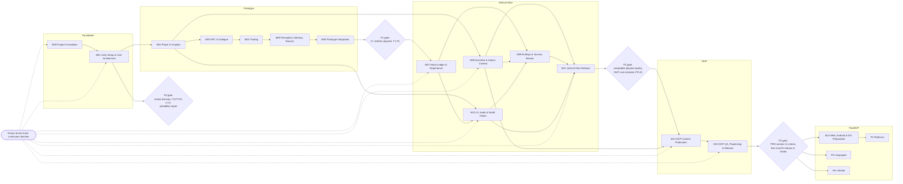

# ROADMAP — خارطة الطريق

خمسة مستويات نضج: **Foundation ← Prototype ← Vertical Slice ← MVP ← PostMVP**. كل مستوى ينتهي ببوابة من [PRD القسم 11](../docs/PRD.md) لا تُعبر إلا بتحقق معاييرها القابلة للقياس. لا تواريخ ولا مدد في هذا الملف عمداً: التقدم يُقاس باكتمال البوابات، والحالة الحالية في [PROJECT_STATUS.md](../PROJECT_STATUS.md). تفاصيل كل مرحلة في [MILESTONES.md](MILESTONES.md)، والمسار الحرج في [DEPENDENCIES.md](DEPENDENCIES.md).

## 1. المستويات

### 1.1 Foundation — الأساس التقني (P0)
| | |
|---|---|
| **المراحل** | [M00](../milestones/M00.md)، [M01](../milestones/M01.md) |
| **النطاق** | نظام التخطيط والمستودع، والمراجع الشرعي وسجلا المصادر والمسائل المعلقة، ومشروع Unity 6 + URP، ونواة المحاكاة الحتمية (GameClock، SeededRng، DecisionLog بخط FR-E4، ScheduledEventQueue)، والحفظ القانوني، وقرار عرض العربية، وقياس الويب والجوال، وهيكل الحوار، وبوابة المحتوى الديني FR-Q2، ومستورد المصحف. |
| **البوابة** | بوابة خروج P0 في [M01](../milestones/M01.md). |

**معايير النجاح القابلة للقياس:**
- قرار عرض العربية مكتوب (واجهة، ونص في العالم، وآيات) بشهادة المراجع، ومسجل كقرار D-003 نهائي في [DECISIONS.md](DECISIONS.md).
- T1 وT7 وT8 خضراء في CI في آخر 3 تشغيلات متتالية.
- تقرير قابلية النقل يذكر الإطارات والحجم والذاكرة لـ WebGL وجوال واحد على أجهزة مصفوفة M00-008.
- بوابة FR-Q2 تُفشل البناء على عينات المحتوى غير المعتمد، وصفر نص آية مكتوب يدوياً.
- صفر مرجع لـ `UnityEngine` أو `System.Random` أو `DateTime.Now` في `Scripts/Simulation`.

### 1.2 Prototype — النموذج الأولي (P1)
| | |
|---|---|
| **المراحل** | [M02](../milestones/M02.md)، [M03](../milestones/M03.md)، [M04](../milestones/M04.md)، [M05](../milestones/M05.md)، [M06](../milestones/M06.md) |
| **النطاق** | سوق رمادي بلا رسوم: لاعب وكاميرا وتفاعل، و3 شخصيات بجداول وحوار Yarn، والتجارة والميزان والغش بأنواعه والاكتشاف المؤجل، والشهود والمعتقدات والشائعات والسمعة المشتقة من المعتقدات، واتهام باطل واحد، و30 سطراً مؤقتاً غير ديني للضمير، وحلقة يوم كاملة. |
| **البوابة** | بوابة خروج P1 في [M06](../milestones/M06.md). |

**معايير النجاح القابلة للقياس:**
- اختبار مع 5 أطفال أو أكثر يجيب عن: هل الإغراء مغرٍ؟ وهل الانكشاف والاتهام عادلان ومفهومان؟ مقابل عتبة مكتوبة في البروتوكول قبل الاختبار.
- T1 إلى T6 خضراء في CI.
- اختبار FR-T5 بلا واجهة يثبت أن الغش أربح قصيراً وأن الأمانة تنمو بالثقة.
- غش سري بلا شهود لا يغيّر السمعة (FR-R2).
- قرار استمرار مكتوب (M06-009) قبل بدء أي نظام من الشريحة العمودية.

### 1.3 Vertical Slice — الشريحة العمودية (P2)
| | |
|---|---|
| **المراحل** | [M07](../milestones/M07.md)، [M08](../milestones/M08.md)، [M09](../milestones/M09.md)، [M10](../milestones/M10.md)، [M11](../milestones/M11.md) |
| **النطاق** | السجل الأخلاقي المخفي، والعواقب السببية، وأحداث الحياة بمعدل واحد، والصوتان الداخليان، والتوبة ودفتر الحقوق ومحور الحقيقة؛ وطبقة القصة ومقطع الفصل الأول المعتمد وعرض الآيات؛ ومحدد النهايات الثماني وتسلسل F5 ونهايتان ومراجعة الرحلة؛ وواجهة RTL كاملة وسوق بالجودة النهائية وبيئة صوتية بلا معازف؛ ثم دمج شريحة من 10 إلى 15 دقيقة. |
| **البوابة** | بوابة خروج P2 في [M11](../milestones/M11.md). |

**معايير النجاح القابلة للقياس:**
- جودة مقبولة في اختبار اللعب مع أطفال وأولياء أمور، مقابل عتبة البروتوكول.
- تقدير كلفة MVP منشور لكل مسار (فن، وكتابة، ومراجعة شرعية، وتسجيل، وبرمجة) من أزمنة الشريحة الفعلية.
- FR-J8 أخضر في CI، ومعه T1 إلى T9.
- 60 إطاراً أو أكثر على Mac M1 في أثقل موضع من الشريحة، وإعادة قياس الويب والجوال منشورة.
- مقطع قصة واحد `verified` و`approved`، وصفر محتوى ديني غير معتمد في البناء.
- قرار استمرار وتثبيت نطاق MVP مكتوب (M11-009).

### 1.4 MVP — الإصدار الأول (P3)
| | |
|---|---|
| **المراحل** | [M12](../milestones/M12.md)، [M13](../milestones/M13.md) |
| **النطاق** | البلدة كاملة، والأدوار الإحدى عشرة، والقصة كاملة في 60 إلى 90 دقيقة بفصولها الثلاثة وخاتمتها، والنهايات الثماني، والحوارات والسطور كاملة، والتسجيل العربي الكامل، والموازنة؛ ثم اختبارات الحفظ على المحتوى الكامل، وتحسين الأداء، والانحدار، والمراجعة الشرعية النهائية، واختبار اللعب، والإصدار المجاني على macOS بالعربية. |
| **البوابة** | بوابة خروج P3 في [M13](../milestones/M13.md) = معايير [PRD القسم 12](../docs/PRD.md). |

**معايير النجاح القابلة للقياس** (نصها الحرفي في [M13](../milestones/M13.md) القسم 9):
- إنهاء القصة الرئيسية ≥ 60%؛ شرح لماذا الغش حرام حتى لو لم يُكشف ≥ 70%؛ فهم أن الصدق لا يُقاس برأي الناس ≥ 70% ممن وصلوا لنهاية "الأمين المظلوم"؛ إعادة اللعب أو تجربة مسار آخر ≥ 40%؛ لا يرون الضمير واعظاً مزعجاً ≥ 70%؛ موافقة أولياء الأمور وتوصيتهم ≥ 80%.
- صفر محتوى ديني منشور دون `verified` و`approved`، وصفر مسائل من [PRD 10](../docs/PRD.md) مفعّلة دون حسم.
- 60 إطاراً على M1، واجتياز FR-J8.
- T1 إلى T9 ناجحة، وصفر فقدان لبيانات الحفظ.
- إصدار مجاني على macOS بالعربية منشور.

### 1.5 PostMVP — التوسعات (P4، P5، P6 وما بعدها)
| المرحلة في PRD | النطاق | المراحل في هذه الخطة | معيار النجاح (بوابة PRD 11) |
|---|---|---|---|
| **P4: توسعة المنصات** | قرار الويب أو الجوال حسب تقارير P0 وP2، وتحكم باللمس، ثم Windows | تحضير فقط في [M14](../milestones/M14.md) (القرار، وتصميم اللمس، والتحقق من العربية وICU). التنفيذ مهام في [BACKLOG.md](BACKLOG.md) تُحوَّل إلى مرحلة بعد القرار | أهداف الأداء لكل منصة، تُثبت أرقامها في قرار M14-001 |
| **P5: توسعة اللغات** | الإنجليزية، ثم التركية والفرنسية والإندونيسية، مع مراجعة شرعية للترجمات | تدقيق الجاهزية فقط في [M14](../milestones/M14.md) (M14-005)؛ الباقي في [BACKLOG.md](BACKLOG.md) | محتوى مترجم معتمد |
| **P6 وما بعدها: توسعة العالم** | عوالم أنبياء جديدة، ومهن جديدة، والمعاملات (الربا والقروض)، والعبادات، والحفظ السحابي بموافقة ولي الأمر، والذكاء الاصطناعي للحوار ([PRD 8.4](../docs/PRD.md))، واللعب الجماعي | مذكرة الحفظ السحابي فقط في [M14](../milestones/M14.md) (M14-004)؛ الباقي في [BACKLOG.md](BACKLOG.md) | تُحدد لكل توسعة على حدة |

M14 غير حاجب: اكتمال MVP تحدده بوابة M13 وحدها. القيد S13 (لا شبكة ولا جمع بيانات) يبقى سارياً حتى قرار صريح لكل توسعة.

## 2. المسارات المتوازية عبر المراحل
المراحل ليست متتابعة بصرامة؛ كل مهمة تبدأ حين تكتمل اعتماداتها بعينها. المسارات التالية تعبر حدود المراحل وتُدار كخطوط عمل مستقلة:

| المسار | يبدأ | يمر بـ | ملاحظة |
|---|---|---|---|
| **المراجعة الشرعية** | M00 (اعتماد المراجع M00-004، وسجل المصادر M00-006، وسجل المسائل M00-007، واسم البلدة M00-005) | شهادة عرض العربية (M01-020..022)، ومخططات المحتوى وبوابة FR-Q2 والمستورد (M01-025..027)، ومراجعة S10 لطرق الغش (M04)، ومقطع الفصل الأول (M08-003..006، 011)، ودفعة الضمير والتوبة (M07-017..019)، والنهايات والمراجعة (M09-008)، والاتجاه الفني والشخصيات والصوت (M10)، وتدقيق بناء الشريحة (M11-005)، والمقاطع والسطور والتسجيل (M12)، والمراجعة النهائية وتدقيق المسائل المعلقة (M13-004، 005) | أطول مسار في المشروع ([PRD 13](../docs/PRD.md)). يعمل على دفعات صغيرة متصلة، وكل ميزة معلقة تعمل بسلوكها الافتراضي المحايد (FR-Q5) حتى الحسم |
| **العمود الفقري للأنظمة** | M01 | M04 ← M05 ← M06 ← M07 ← M09 ← M11 ← M12 ← M13 | المسار الحرج للإطلاق؛ أي تأخير فيه يؤخر الإصدار مباشرة |
| **السرد والمحتوى الإسلامي** | بعد M01 وM02 | M08 بالتوازي مع M03–M07، ثم مقاطع M12-010..012 قبل بوابة M11 | لا ينتظر بوابة النموذج؛ يملأ زمن انتظار المراجع |
| **الفن والصوت** | الاتجاه الفني M10-006 بعد اسم البلدة M00-005 | أصول السوق ونماذج الشخصيات والإضاءة (M10) أثناء اكتمال أنظمة M07 وM09، ثم أصول البلدة M12-002، ثم تحسين الأداء M13-002 | يُفضَّل بدء الإنتاج الثقيل بعد بوابة M06 ("اختبار المتعة في P1 قبل الرسوم"، [PRD 13](../docs/PRD.md))؛ هذه توصية لا اعتماد رسمي |
| **الواجهة** | دليل الواجهة M10-001 بعد قرار العربية M01-022 | واجهة مراجعة الرحلة M09-007، والقائمة والإعدادات (M10)، والتعليم المدمج M12-016 | M10-001 يُنفذ مبكراً لأنه يحجب M09 |
| **الحفظ والحتمية** | T1 وT7 وT8 في M01 | T2 وT5 (M05)، وT3 وT4 وT6 (M06)، وT9 ومدقق الاتساق FR-S7 (M07)، والمجموعة الكاملة واختبار التحمل (M13-001) | كل اختبار يدخل CI فور إنشائه ولا يُعطَّل |
| **اختبار اللعب** | بروتوكول M06-007 (بلا اعتمادات) | النموذج M06-008، والشريحة M11-006، وMVP M13-006 | العتبة تُكتب قبل كل اختبار؛ موافقة أولياء الأمور شرط |
| **المنصات** | مصفوفة الأجهزة M00-008 | قياس P0 (M01-016..018، 023)، وإعادة القياس P2 (M11-004)، والقرار والتحضير (M14) | يمنع قرار منصة أعمى في P4 |

## 3. المخطط العام
بلا تواريخ ولا مدد. الأسهم المتصلة اعتماد بين المراحل، والمعيّنات بوابات، والأسهم المتقطعة مسار المراجعة الشرعية المستمر.

## 4. قواعد السير على الخارطة
- لا تُعبر بوابة قبل تحقق كل شروط القسم 10 في ملف مرحلتها؛ تحديث حالة المرحلة يدوي بعد التحقق ([AGENTS.md](../AGENTS.md) القسم 6).
- كل بوابة تنتهي بقرار مكتوب في [DECISIONS.md](DECISIONS.md) (استمرار، أو تعديل، أو إيقاف)، وأي تعديل للنطاق ينعكس في ملفات المهام ثم `python3 tools/plan.py sync`.
- أي فكرة خارج نطاق المستوى الحالي تذهب إلى [BACKLOG.md](BACKLOG.md)، لا إلى مرحلة جارية.
- المخاطر العابرة للمراحل وتحديثاتها في [RISKS.md](RISKS.md).
